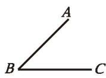
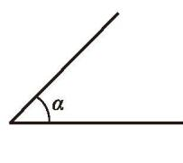
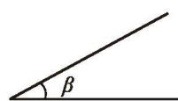

# 第5题 · 用尺规完成下列作图：

5. 用尺规完成下列作图：

(1) 如图 (1), 已知 $\angle ABC$ , 以点 $B$ 为顶点, 射线 $BA$ 为一边, 在 $\angle ABC$ 外作一个角, 使它等于 $\angle ABC$ ;

  
(2)

  
(第5题)

(2)如图(2),已知 $\angle \alpha ,\angle \beta$ ，作一个角，使它等于 $\angle \alpha$ 与 $\angle \beta$ 的和。
