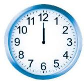
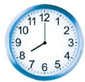
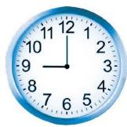
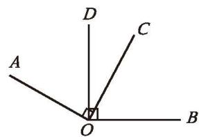
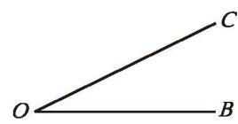

# 第8题 · (1) 如图, 分别确定四个城市相应钟表上时针与分针所成角的度数。

8. (1) 如图, 分别确定四个城市相应钟表上时针与分针所成角的度数。

  
巴黎

  
伦敦

  
(第8题)  
北京

  
东京

(2) 每经过 $1 \mathrm{~h}$ , 时针转过多少度? 每经过 $1 \mathrm{~min}$ , 分针转过多少度?

(3) 当时钟指向上午 10:10 时, 时针与分针的夹角是多少度? ※ (4) 请你的同伴任意报一个时间 (精确到分), 你来确定时针与分针的夹角。 9. 如图 (1), $\angle AOC$ 和 $\angle BOD$ 都是直角。

(1) 如果 $\angle DOC = 28^{\circ}$ , 那么 $\angle AOB$ 的度数是多少?

(2) 找出图 (1) 中相等的角。如果 $\angle DOC \neq 28^{\circ}$ , 它们还会相等吗?

(3) 如果 $\angle DOC$ 变小, 那么 $\angle AOB$ 如何变化?

  
(1)  
(2)  
(第9题)

(4) 在图 (2) 中利用能够画直角的工具再画一个与 $\angle COB$ 相等的角。
