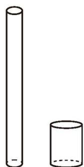

# 第1题 · 两个圆柱体容器如图所示, 它们的底面直径分别为 4 {~cm} 和 8 {~cm} , 高分别为 39

1. 两个圆柱体容器如图所示, 它们的底面直径分别为 $4 \mathrm{~cm}$ 和 $8 \mathrm{~cm}$ , 高分别为 $39 \mathrm{~cm}$ 和 $10 \mathrm{~cm}$ 。先在右侧容器中倒满水, 然后将其倒入左侧容器中。倒完以后, 左侧容器中的水面离容器口有多少厘米? 小刚是这样做的: 设倒完以后, 左侧容器中的水面离容器口有 $x \mathrm{~cm}$ 。列方程 $\pi \times 2^{2} \times (39 - x) = \pi \times 4^{2} \times 10$ 。解得 $x = -1$ 。请你对他的结果作出合理的解释。

  
(第1题)
