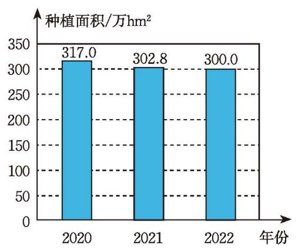
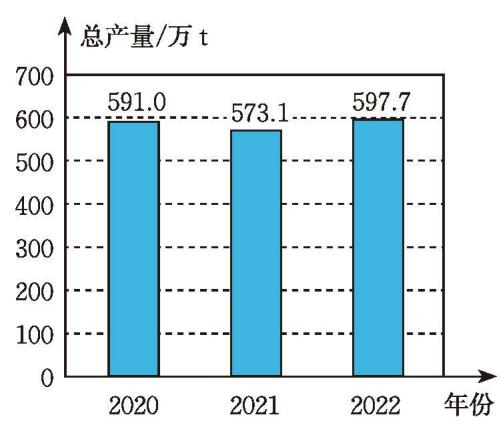

# 第13题 · 根据 2020—2022 年全国棉花产量公告, 绘制了如下两幅统计图, 根据统计图回答下列问题－

13. 根据 2020—2022 年全国棉花产量公告, 绘制了如下两幅统计图, 根据统计图回答下列问题:

(1) 2020 年全国棉花平均每公顷产量大约是多少? 2021 年和 2022 年呢?

(2) 根据图中的统计数据, 你还能得到什么信息?

(2)

(3)

2020—2022年全国棉花种植面积

2020—2022年全国棉花总产量  
  
(第13题)
