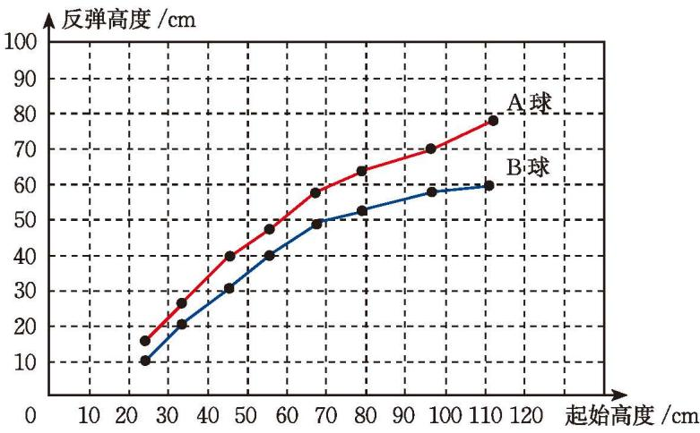

# 第16题 · 下面是 A, B 两球从不同高度自由下落到地面后反弹高度的统计图。

16. 下面是 A, B 两球从不同高度自由下落到地面后反弹高度的统计图。

A, B 两球反弹高度统计图  

(1)比较两个球反弹高度的变化情况,哪个球的弹性大？

(2) 如果两个球下落的起始高度继续增加, 那么你认为 A 球的反弹高度会继续增加吗? B 球呢?

(3) 分别比较 A 球、B 球的反弹高度和起始高度, 你认为反弹高度会超过起始高度吗?
