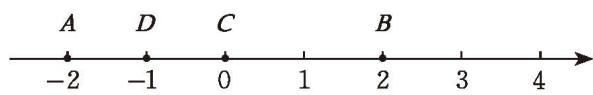
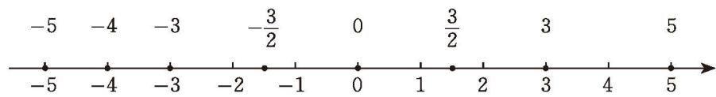

# 例4(1)如图2-5, 数轴上点 A, B, C, D 分别表示什么数－

例4(1)如图2-5, 数轴上点 $A, B, C, D$ 分别表示什么数?

  
图2-5

(2) 画出数轴, 并用数轴上的点表示下列各数:

$$
\frac {3}{2}, - 3, 0, 5, - 4, - \frac {3}{2}, 3, - 5 _ {\circ}
$$

解:(1) 点 A 表示 -2, 点 B 表示 2, 点 C 表示 0, 点 D 表示 -1;

(2) 如图 2-6 所示。

  
图2-6
