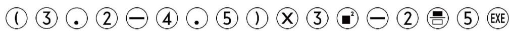
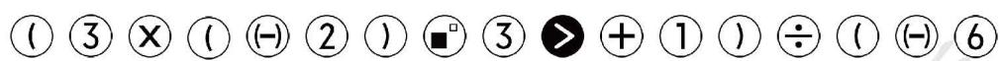

# 例3 用计算器求下列各式的值－

例3 用计算器求下列各式的值:

(1) $(3.2 - 4.5) \times 3^{2} - \frac{2}{5}$ ;

(2) $[3 \times (-2)^{3} + 1] \div \left(-\frac{6}{5}\right)$ 。

解: (1) 按键顺序为

计算器显示结果为 $-\frac{121}{10}$ ，可以按 $\uparrow$ (EXE) 键切换为小数格式 -12.1，所以 $(3.2-4.5)\times3^{2}-\frac{2}{5}=-12.1$ 。

(2) 按键顺序为

计算器显示结果为 $\frac{115}{6}$ 。
