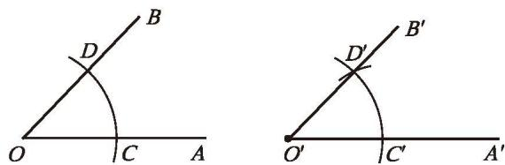

# 例2 如图 4-29，已知 AOB ，用尺规作 A'O'B' ，使 A'O'B' = A

例2 如图 4-29，已知 $\angle AOB$ ，用尺规作 $\angle A'O'B'$ ，使 $\angle A'O'B' = \angle AOB$ 。作法：1. 作射线 $O'A'$ （如图 4-29）。

2. 以点 O 为圆心，以任意长为半径作弧，交 OA 于点 C，交 OB 于点 D。

3. 以点 $O'$ 为圆心, 以 $OC$ 的长为半径作弧, 交 $O'A'$ 于点 $C'$ 。

4. 以点 $C'$ 为圆心, 以 $CD$ 的长为半径作弧, 交前面的弧于点 $D'$ 。

5. 过点 $D'$ 作射线 $O'B'$ 。

$\angle A^{\prime}O^{\prime}B^{\prime}$ 就是所要作的角。

  
图4-29
