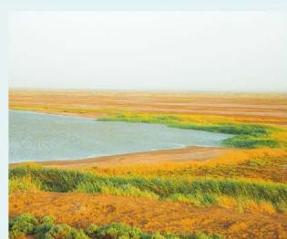
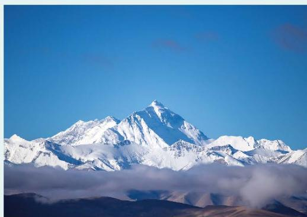
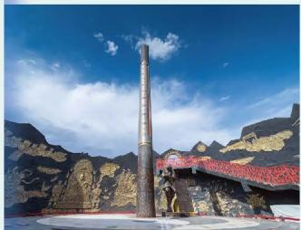

# 世界上最高的山峰是珠穆朗玛峰，其海拔大约是 8848.86 m，吐鲁番盆地最低处的海拔大约是 -154.31 m。你

世界上最高的山峰是珠穆朗玛峰，其海拔大约是 8848.86 m，吐鲁番盆地最低处的海拔大约是 -154.31 m。你能说出 -154.31 m 的含义吗？怎样计算珠穆朗玛峰的海拔和吐鲁番盆地最低处的海拔相差多少呢？

本章将在小学学习的基础上引入负数，将数的范围扩充到有理数。你将经历从具体情境中抽象出负数的过程，理解有理数运算的意义并进行正确运算，通过归纳、类比、转化等发现一些数学结论，提高运算能力和推理能力，发展应用意识等。

在本章学习过程中，你可以持续思考以下问题：

为什么要引入负数？

研究一类“新”数，一般会经历怎样的过程？

不回答
