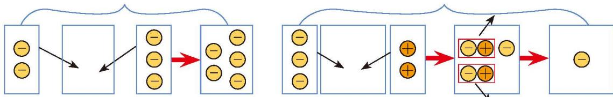

某班举行知识竞赛，评分标准是：答对1题加1分，答错1题扣1分，不回答得0分。每个参赛队的基本分均为0分。

加 1 分、扣 1 分，
得 0 分；扣 1 分、
加 1 分，得 0 分。

“加 1 分、扣 1 分，得 0 分” “扣 1 分、加 1 分，得 0 分” 可以分别用如下算式表示：

$$
(+ 1) + (- 1) = 0, (- 1) + (+ 1) = 0 _ {\circ}
$$

(1) 第一环节和第二环节各有 5 道题。三个参赛队在前两个环节的得分情况见下表, 你能把下表补充完整吗? 你是怎么做的? 与同伴进行交流。

<table><tr><td>参赛队</td><td>第一环节的得分</td><td>第二环节的得分</td><td>前两个环节的得分之和</td><td>算式表示</td></tr><tr><td>第一队</td><td>2</td><td>3</td><td></td><td></td></tr><tr><td>第二队</td><td>-2</td><td>-3</td><td></td><td></td></tr><tr><td>第三队</td><td>-3</td><td>2</td><td></td><td></td></tr></table>

(2) 小明用 1 个 ⊕ 表示 +1，用 1 个 ⊖ 表示 -1，用 ⊕ ⊖ 直观表示 (+1) + (-1) = 0，用 ⊖ ⊕ 直观表示 (-1) + (+1) = 0。他列出了两个算式，并给出了直观的解释，你能理解他的做法吗？

$$
(- 2) + (- 3) = - 5
$$

$$
(- 3) + 2 = - 1
$$

(3) 如果有第四个参赛队, 那么第四队前两个环节的得分可能会出现哪些情形, 据此可以列出哪些算式? 你能直观解释运算过程和结果吗?

