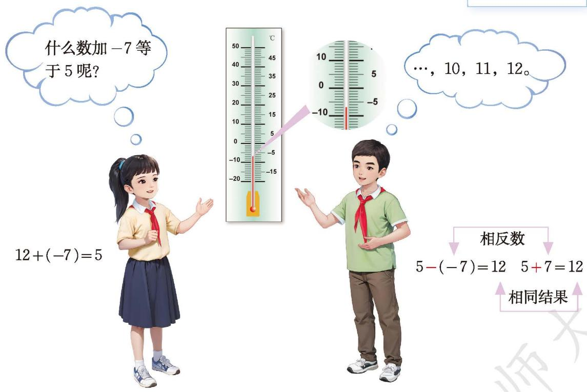

<table><tr><td>城市</td><td>天气</td><td>高温</td><td>低温</td><td>城市</td><td>天气</td><td>高温</td><td>低温</td></tr><tr><td>北京</td><td>晴转多云</td><td>5</td><td>-7</td><td>西宁</td><td>多云</td><td>-1</td><td>-12</td></tr><tr><td>哈尔滨</td><td>晴</td><td>-14</td><td>-19</td><td>兰州</td><td>多云</td><td>1</td><td>-9</td></tr><tr><td>长春</td><td>晴</td><td>-11</td><td>-19</td><td>西安</td><td>阴转雨夹雪</td><td>2</td><td>-2</td></tr><tr><td>沈阳</td><td>晴</td><td>-4</td><td>-15</td><td>拉萨</td><td>晴</td><td>8</td><td>-7</td></tr><tr><td>天津</td><td>晴转多云</td><td>4</td><td>-6</td><td>成都</td><td>阴转小雨</td><td>8</td><td>5</td></tr><tr><td>呼和浩特</td><td>晴</td><td>-2</td><td>-14</td><td>重庆</td><td>小雨转阴</td><td>10</td><td>8</td></tr><tr><td>乌鲁木齐</td><td>晴</td><td>-8</td><td>-14</td><td>贵阳</td><td>阴</td><td>8</td><td>1</td></tr><tr><td>银川</td><td>多云</td><td>0</td><td>-9</td><td>昆明</td><td>阵雨</td><td>13</td><td>7</td></tr></table>

图2-8

图 2-8 是 2023 年 1 月 1 日我国部分城市天气情况（单位：℃）。

北京的最高气温为 $5^{\circ} \mathrm{C}$ , 最低气温为 $-7^{\circ} \mathrm{C}$ , 这一天北京的温差为多少? 你是怎么算的?

$$
5 - (- 7) = ?
$$

减法是加法的逆运算。

