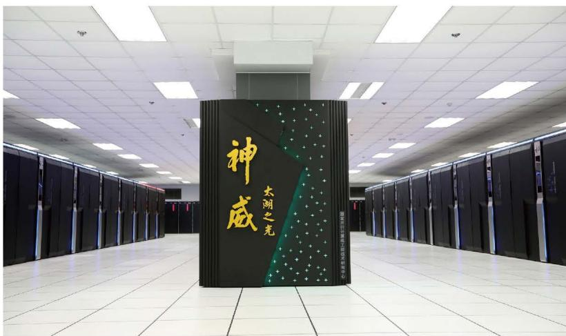

# 2016 年，由我国自主研发的 “神威·太湖之光” 超级计算机（如图 2-13）运算速度可达到 1 250 000

2016 年，由我国自主研发的 “神威·太湖之光” 超级计算机（如图 2-13）运算速度可达到 1 250 000 000 亿次 /s。假设一个人每秒可做一次简单的运算，要完成 1 250 000 000 亿次运算大约需要多少年？用科学记数法表示结果，并与同伴进行交流。

  
图2-13
