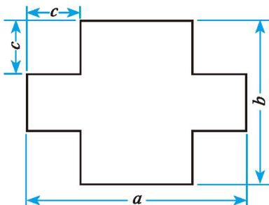
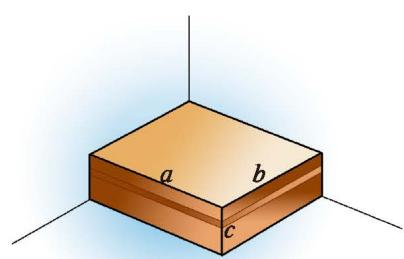

# 请列出下列问题中的代数式，并指出其中：①哪些是单项式？单项式的系数和次数分别是多少？②哪些是多项式？多项式的次数是多

请列出下列问题中的代数式，并指出其中：①哪些是单项式？单项式的系数和次数分别是多少？②哪些是多项式？多项式的次数是多少？

(1) 如图 3-4, 一个十字形花坛铺满了草皮, 这个花坛草地面积是多少?

  
图3-4

(2) 当水结冰时, 其体积大约会比原来增加 $\frac{1}{9}, x \mathrm{~m}^{3}$ 的水结成冰后体积是多少?

(3)如图 3-5, 一个长方体的箱子紧靠墙角, 它的长、宽、高分别是 $a, b, c$ 。这个箱子露在外面的表面积是多少?

(4) 某件商品的成本价为 $a$ 元, 按成本价提高 $15 \%$ 标价, 后又以八折 (即按标价的 $80 \%$ ) 销售, 这件商品的售价为多少元?

图3-5
