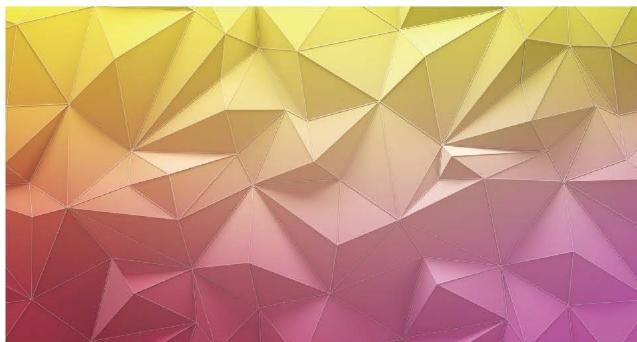
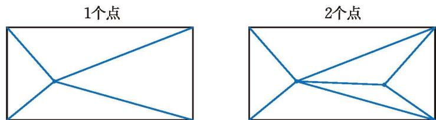

在本章学习过程中，我们经历过很多次“归纳”的过程，即从几种特殊情形出发，进而找到一般规律的过程。归纳是发现数学结论、解决数学问题的一种重要策略。

问题 “低多边形风格” 是一种数字艺术设计风格。它将整个区域分割为若干三角形，通过把相邻三角形涂上不同颜色，产生立体及光影的效果，随着三角形数量增加，效果更为斑斓绚丽（如图 3-9）。

  
图3-9

将长方形区域分割成三角形的过程是：在长方形内取一定数量的点，连同长方形的4个顶点，逐步连接这些点，保证所有连线不再相交产生新的点，直到长方形内所有区域都变成三角形。

如图 3-10，当长方形内有 1 个点时，可分得 4 个三角形；当长方形内有 2 个点时，可分得 6 个三角形（不计被分割的三角形）。

  
图3-10

当长方形内有 35 个点时，可分得多少个三角形？
