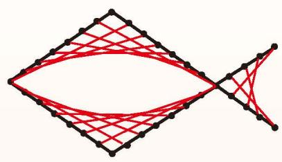
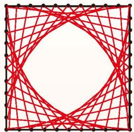
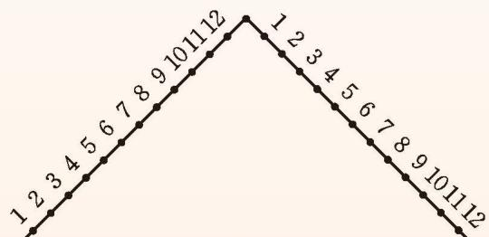

图 4-8 中的图案漂亮吗？这些图案中似乎包含了一些曲线，其实它们都是由多条线段构成的。

请你按照下面的步骤试一试。

  
图4-8

  
(1) 画一个角 (如图 4-9);

(2) 在角的两边取距离相等的点;

(3) 将这些点按如图所示编上号码;

(4) 把号码相同的点用线段连起来。

看一看，你得到了什么图案？有趣吗？

利用这个办法尝试画出上面的图案。你也可以发挥想象，自己创作出更有趣的图案来！

  
图4-9

尝试用数学软件制作图案。
