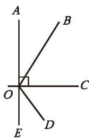

根据图 4-25，求解下列问题：

(1) 比较 $\angle AOB, \angle AOC, \angle AOD, \angle AOE$ 的大小, 并指出其中的锐角、直角、钝角、平角。

(2)试比较 $\angle BOC$ 和 $\angle DOE$ 的大小。

(3) 小亮通过折叠的方法, 使 $OD$ 与 $OC$ 重合, $OE$ 落在 $\angle BOC$ 的内部, 所以 $\angle BOC > \angle DOE$ 。你能理解这种方法吗?

  
图4-25

(4) 请在图中画出小亮折叠的折痕 $OF, \angle DOF$ 与 $\angle COF$ 有什么大小关系?
