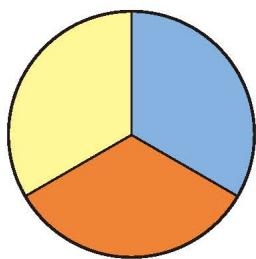

# (1) 如图 4-36, 将一个圆分成三个大小相同的扇形,你能算出它们的圆心角的度数吗－ 你知道每个扇形的面积和整个

(1) 如图 4-36, 将一个圆分成三个大小相同的扇形,你能算出它们的圆心角的度数吗? 你知道每个扇形的面积和整个圆的面积的关系吗?

(2) 画一个半径是 $2 \mathrm{~cm}$ 的圆, 并在其中画一个圆心角为 $60^{\circ}$ 的扇形, 你会计算这个扇形的面积吗? 与同伴进行交流。

  
图4-36
