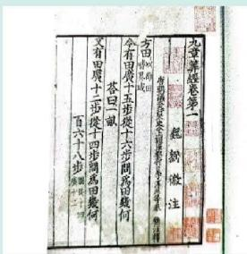
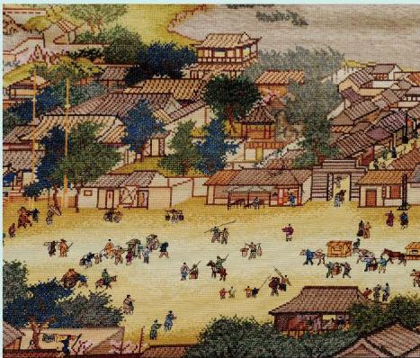

# 《九章算术》第七章 “盈不足” 中有这样一个问题：“今有共买物，人出八，盈三；人出七，不足四。问：人数、物价各几何？

《九章算术》第七章 “盈不足” 中有这样一个问题：“今有共买物，人出八，盈三；人出七，不足四。问：人数、物价各几何？” 你知道我国古人是如何解决这个问题的吗？

本章你将经历从具体问题情境中发现等量关系、抽象出方程模型的过程，利用等式的基本性质求解一元一次方程，并运用一元一次方程解决实际问题，感受方程的模型思想和方程求解的转化思想，发展抽象能力和运算能力。

在本章学习过程中，你可以持续思考以下问题：

为什么要学习方程？方程的本质是什么？

如何得到一个方程？求解方程的基本思路是什么？
