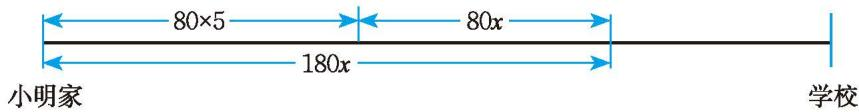

小明家与他就读的学校相距 1000 m。一天，小明以 80 m/min 的速度出发，出发后 5 min，小明的爸爸发现小明忘了带语文书。于是，爸爸立即以 180 m/min 的速度沿同一条路去追小明，并且在途中追上了他。爸爸追上小明用了多长时间？追上小明时，距离学校还有多远？

(1) 问题中有哪些已知量和未知量?

(2) 想象一下追及的过程, 你能用一个图直观表示问题中各个量之间的关系吗?

(3) 你是怎样列出方程的？与同伴进行交流。

设爸爸追上小明用了 $x \min$ 。当爸爸追上小明时，两人所行路程相等，如图5-3所示。

  
图5-3

画图分析数量关系是一种有效方法。

根据等量关系，可列出方程：\_\_\_\_。

解这个方程，得 x=\_\_\_\_。

因此，爸爸追上小明用了\_\_\_\_min，此时距离学校还有\_\_\_\_m。

根据相等量的两种不同表达式就可以建立等量关系，列出方程了。
