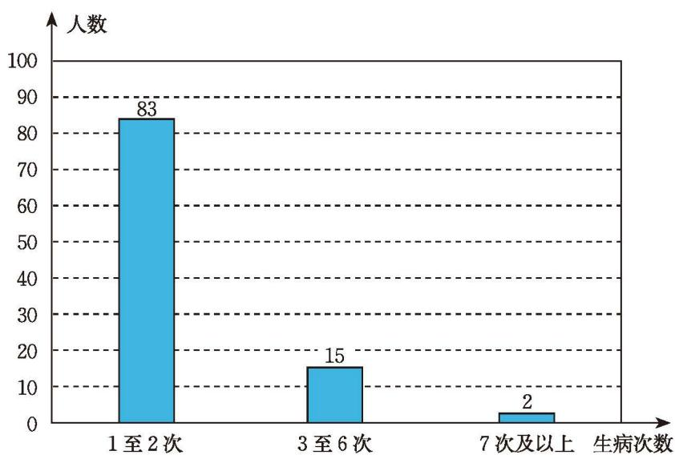
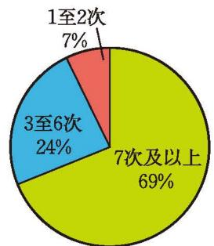

为了解你所在地区 70 岁以上老年人的健康状况，你准备怎样收集数据？下面分别是小明、小颖、小亮所在三个小组的调查结果。

我们小组在公园里调查了 100 名 70 岁以上老年人，他们一年中生病的次数如图 6-5 所示。

  
图6-5

我们小组在医院调查了 100 名 70 岁以上老年患者，他们一年中生病的次数如图 6-6 所示。

  
图6-6

我们小组调查了 10 名 70 岁以上老年邻居，他们一年中生病的次数如右表所示。

<table><tr><td>生病的次数</td><td>人数</td></tr><tr><td>1至2次</td><td>4</td></tr><tr><td>3至6次</td><td>5</td></tr><tr><td>7次及以上</td><td>1</td></tr></table>

(1) 你同意他们的做法吗？说说你的理由。

(2) 为了解该地区 70 岁以上老年人的健康状况, 你认为应当怎样收集数据? 与同伴进行交流。

(3) 小华利用派出所的户籍网随机调查 ① 了该地区 $10\%$ 的 70 岁以上老年人, 发现他们一年平均生病 3 次左右。你认为他的调查方式如何?
