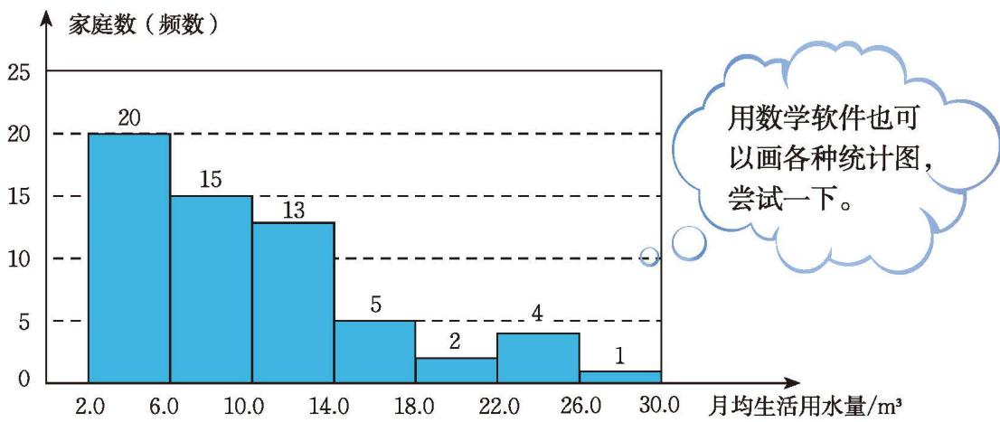

# (3) 统计每组中数据出现的次数－

(3) 统计每组中数据出现的次数:

<table><tr><td>分组</td><td>家庭数(频数)</td><td>分组</td><td>家庭数(频数)</td></tr><tr><td>2.0~6.0</td><td>20</td><td>18.0~22.0</td><td>2</td></tr><tr><td>6.0~10.0</td><td>15</td><td>22.0~26.0</td><td>4</td></tr><tr><td>10.0~14.0</td><td>13</td><td>26.0~30.0</td><td>1</td></tr><tr><td>14.0~18.0</td><td>5</td><td></td><td></td></tr></table>

(4) 绘制频数直方图（如图 6-12）:

  
图6-12
