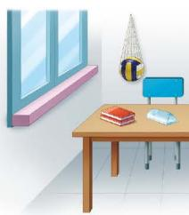
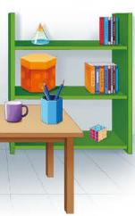
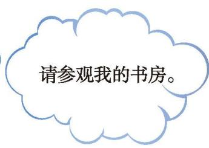
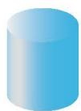
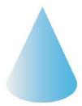
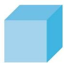
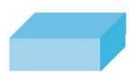
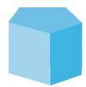
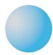

(1) 小学学过哪些几何体? 如图 1-1, 在小颖的书房中, 哪些物体的形状与你在小学学过的几何体类似?

(2) 请找出小颖的书房中与笔筒形状类似的物体, 并与同伴进行交流。

  
图 1-1

  
请参观我的书房。

小颖的书房中与笔筒形状类似的几何体称为[[棱柱]]。图 1-2 中是一些常见的几何体。

  
圆柱  
(circular cylinder)

  
圆锥  
(circular cone)

  
正方体  
(cube)

图1-2  
  
长方体
(cuboid)

  
棱柱  
(prism)

  
球  
(sphere)
