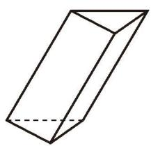
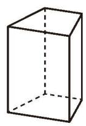
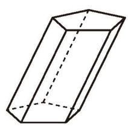
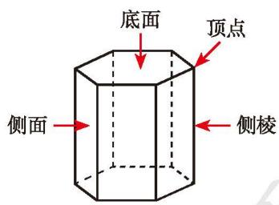
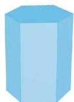
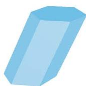

(1) 图 1-3 中指出了六棱柱的顶点、侧棱、侧面和底面, 请你指出图中其

  
三棱柱

  
四棱柱

  
五棱柱  
图1-3

  
六棱柱

他棱柱的顶点、侧棱、侧面和底面。

(2)棱柱的侧棱、侧面和底面分别有什么特点?

在棱柱中，相邻两个面的交线叫作[[棱]]（edge），相邻两个侧面的交线叫作[[侧棱]]。棱柱的所有侧棱长都相等。棱柱的上、下底面的形状相同，侧面的形状都是平行四边形。

人们通常根据底面图形的边数将棱柱分为三棱柱、四棱柱、五棱柱、六棱柱……它们底面图形的形状分别为三角形、四边形、五边形、六边形……

长方体、正方体都是四棱柱。

棱柱可以分为[[直棱柱]]和斜棱柱（如图 1-4）。本书今后主要讨论直棱柱（简称棱柱）。直棱柱的侧面是长方形。

  
直棱柱

  
斜棱柱  
图1-4
