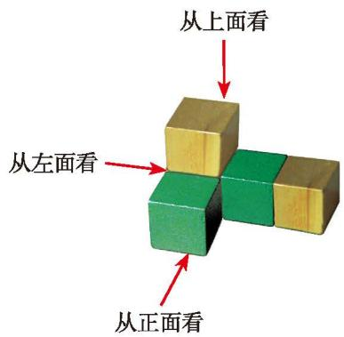
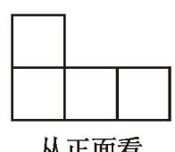
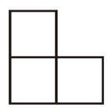
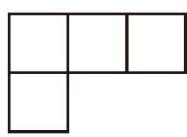

在小学，我们曾经辨认过从正面、左面（或右面）和上面三个不同方向观察同一物体时看到的物体的形状图。例如，图 1-21 是由大小相同的小立方块搭成的几何体，从正面、左面、上面看到的这个几何体的形状图如图 1-22 所示。

  
图1-21

  
从正面看

  
从左面看

  
图 1-22  
从上面看

请你用 6 个大小相同的小立方块搭一个几何体，然后请同伴画出从正面、左面、上面看到的这个几何体的形状图。
