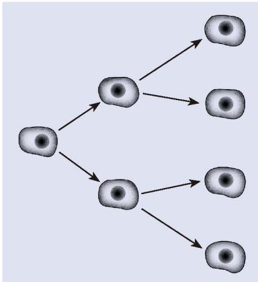
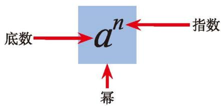

如图 2-11，某种细胞每过 30 min 便由 1 个分裂成 2 个。经过 5 h，这种细胞能由 1 个分裂成多少个？

1 个细胞经过 30 min 分裂成 2 个，经过 1 h 分裂成 $2 \times 2$ 个，经过 $\frac{3}{2}$ h 分裂成 $2 \times 2 \times 2$ 个……

经过 5h 分裂 10 次，分裂成

$$
\overbrace {2 \times 2 \times \cdots \times 2 \times 2} ^ {1 0 \text {个} 2} = 1 0 2 4 (\text {个}) _ {\circ}
$$

  
图2-11

$$
\frac {1 0 \text {个} 2}{2 \times 2 \times \cdots \times 2 \times 2}
$$

为了简便，可将 $2\times2\times\cdots\times2\times2$ 记为 $2^{10}$ 。

一般地， $n$ 个相同的因数 $a$ 相乘，记作 $a^n$ ，即

$$
\overbrace {a \times a \times \cdots \times a} ^ {n \text {个} a} = a _ {\circ} ^ {n}
$$

这种求 n 个相同因数 a 的积的运算叫作[[乘方]]（power），乘方的结果叫作[[幂]]（power），a 叫作[[底数]]（base number），n 叫作[[指数]]（exponent）， $a^{n}$ 读作 “a 的 n 次幂”（或 “a 的 n 次方”）。

