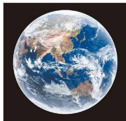

观察图 2-12 中的数据，如何简单地表示这些大数呢？

  
第七次全国人口普查时，我国全国总人口约为1440000000人

  
地球半径约为 6400000m

图2-12  
  
光在真空中的传播速度约为300 000 000 m/s

我们可以借用乘方的形式表示大数。例如：

1 440 000 000 可以表示成 $1.44 \times 10^{9}$ ;

6 400 000 可以表示成 $6.4 \times 10^{6}$ ;

300 000 000 可以表示成 $3 \times 10^{8}$ 。

一般地，

一个大于 10 的数可以表示成 $a \times 10^{n}$ 的形式, 其中 $1 \leqslant a < 10^{①}$ , $n$ 是正整数, 这种记数方法叫作[[科学记数法]] (scientific notation)。

小于 -10 的数也可以用类似的方法表示，如 -2590000 可以表示成 $-2.59 \times 10^{6}$ 。
