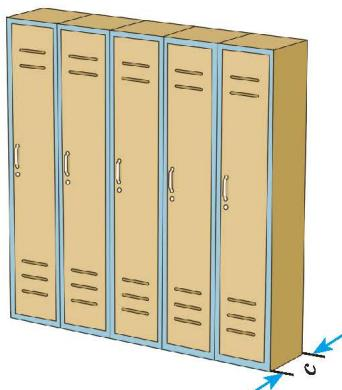
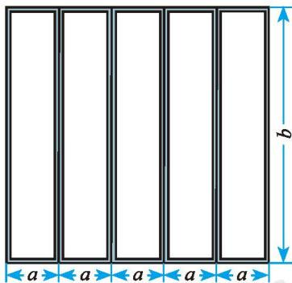

一个组合柜如图 3-2 所示，内部用隔板纵向分隔成 5 个独立的小柜子（如图 3-3），柜门由 5 个完全相同的长方形组成。

  
图3-2

  
图3-3

(1) 若要在 5 个柜门的周边都贴上装饰条, 则所需装饰条的总长度是多少?

(2) 若要给柜门外表面喷漆, 则需要喷漆的面积是多少 (边框缝隙忽略不计)?

(3) 设柜子的进深为 $c$ (如图 3-2), 则整个柜子的容积是多少 (柜门、隔板及背板的厚度忽略不计)?

像 5ab, 5abc, 3v, 6p 等，它们都是数与字母的乘积，这样的代数式叫作[[单项式]]（monomial）。单独一个数或一个字母也是单项式。

几个单项式的和叫作[[多项式]]（polynomial），如 $5a + 5a + 10b$ ， $10x + 5y$ ， $4 + 3(x - 1)$ 等都是多项式。单项式和多项式统称[[整式]]（integral expression）。

单项式中的数字因数叫作这个[[单项式的系数]]（coefficient），如 5ab 的系数是 5，3v 的系数是 3。所有字母的指数和叫作这个[[单项式的次数]]①（degree of monomial），如 5ab 是 2 次的，3v 是 1 次的。

在多项式中, 每个单项式叫作[[多项式的项]] (term), 如多项式 $10 x + 5 y$ 是 $10 x$ 与 $5 y$ 两项的和。一个多项式中, 次数最高的项的次数, 叫作这个[[多项式的次数]]。如 $10 x + 5 y$ 是 1 次的, $a^2 b + 2 a$ 是 3 次的。
