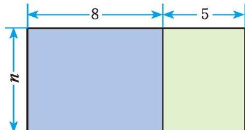

图 3-6 中的长方形由两个小长方形组成。

（1）利用图 3-6 化简 $8n + 5n$ ，并用运算律解释你的化简结果。

（2）你能用类似的方法化简 $2xy + 3xy$ 及 $-7a^{2}b + 2a^{2}b$ 吗？

  
图3-6

根据乘法对加法的分配律可得

$$
\begin{array}{l} 8 n + 5 n = (8 + 5) n = 1 3 n, \\ 2 x y + 3 x y = (2 + 3) x y = 5 x y, \\ - 7 a ^ {2} b + 2 a ^ {2} b = (- 7 + 2) a ^ {2} b = - 5 a ^ {2} b _ {\circ} \end{array}
$$

字母可以和数一样进行运算。

像 8n 与 5n, 2xy 与 3xy, $-7a^{2}b$ 与 $2a^{2}b$ 这样所含字母相同，并且相同字母的指数也相同的项，叫作[[同类项]]（like terms）。

把同类项合并成一项叫作[[合并同类项]]（unite like terms）。例如，

$$
8 n + 5 n = 1 3 n, 2 x y + 3 x y = 5 x y, - 7 a ^ {2} b + 2 a ^ {2} b = - 5 a ^ {2} b _ {\circ}
$$
