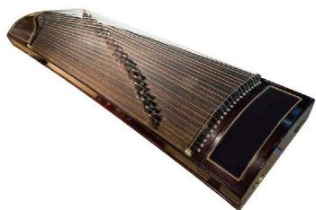
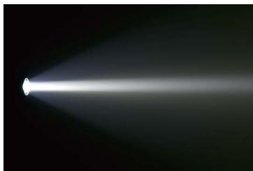

# 绷紧的琴弦（如图 4-1）、黑板的边沿都可以近似地看作线段（segment）。线段有两个端点。

绷紧的琴弦（如图 4-1）、黑板的边沿都可以近似地看作[[线段]]（segment）。线段有两个端点。

将线段向一个方向无限延长就形成了[[射线]]（ray）。手电筒、探照灯所射出的光线（如图4-2）可以近似地看作射线。射线有一个端点。

将线段向两个方向无限延长就形成了[[直线]]（line）。直线没有端点。

  
图4-1

  
图4-2
