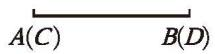
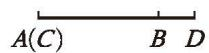
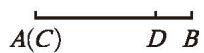
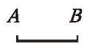
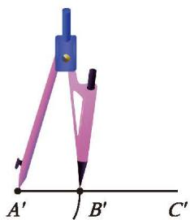
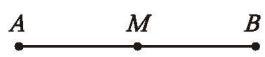

# 如果直接观察难以判断，我们可以有两种方法进行比较：

如果直接观察难以判断，我们可以有两种方法进行比较：

一种方法是用刻度尺量出它们的长度，再进行比较；

另一种方法是把其中的一条线段移到另一条线段上去，将其中的一个端点重合在一起加以比较（如图 4-12）。

线段 $AB$ 等于线段 $CD$ , 记作 $AB = CD$

线段 $AB$ 大于线段 $CD$ , 记作 $AB > CD$

线段 $AB$ 小于线段 $CD$ , 记作 $AB < CD$

图4-12

用尺规作图①的方法可以将一条线段移到另一条线段上。

例如图 4-13, 已知线段 $AB$ , 用尺规作一条线段等于已知线段 $AB$ 。

作法：1. 作射线 $A^{\prime} C^{\prime}$ (如图4-14)。

2. 用圆规在射线 $A^{\prime} C^{\prime}$ 上截取 $A^{\prime} B^{\prime} = A B$ 。

线段 $A'B'$ 就是所要作的线段。

  
图4-13

  
图4-14

  
图4-15

如图 4-15, 点 $M$ 把线段 $AB$ 分成相等的两条线段 $AM$ 与 $BM$ , 点 $M$ 叫作线段 $AB$ 的[[中点]] (midpoint)。这时 $AM = BM = \frac{1}{2} AB$ (或 $AB = 2AM = 2BM$ )。
