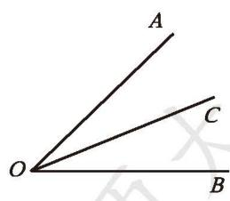

# 从一个角的顶点引出的一条射线，把这个角分成两个相等的角，这条射线叫作这个角的平分线（angle bisector）。

从一个角的顶点引出的一条射线，把这个角分成两个相等的角，这条射线叫作这个[[角的平分线]]（angle bisector）。

如图 4-26，射线 OC 是 $\angle AOB$ 的平分线。这时， $\angle AOC = \angle BOC = \frac{1}{2} \angle AOB$ （或 $\angle AOB = 2 \angle AOC = 2 \angle BOC$ ）。

  
图4-26
