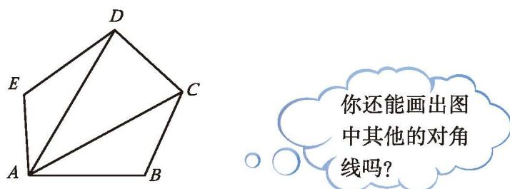

# 三角形、四边形、五边形、六边形等都是多边形①（polygon），它们都是由若干条不在同一直线上的线段首尾顺次相连组成

三角形、四边形、五边形、六边形等都是[[多边形]]①（polygon），它们都是由若干条不在同一直线上的线段首尾顺次相连组成的封闭平面图形。

如图 4-32, 在多边形 $ABCDE$ 中, 点 $A, B, C, D, E$ 是多边形的顶点; 线段 $AB, BC, CD, DE, EA$ 是多边形的边; $\angle EAB$ , $\angle ABC$ , $\angle BCD$ , $\angle CDE$ , $\angle DEA$ 是多边形的内角 (可简称为多边形的角); $AC$ , $AD$ 都是连接不相邻两个顶点的线段, 像这样的线段叫作[[多边形的对角线]] (diagonal)。

  
图4-32
