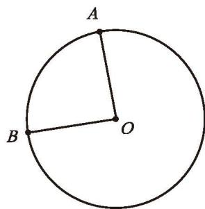

# 如图 4-35，平面上，一条线段 OA 绕着它固定的一个端点 O 旋转一周，另一个端点 A 所形成的图形叫作圆（ci

如图 4-35，平面上，一条线段 OA 绕着它固定的一个端点 O 旋转一周，另一个端点 A 所形成的图形叫作[[圆]]（circle）。固定的端点 O 称为[[圆心]]（center of a circle），线段 OA 称为[[半径]]（radius）。

圆上任意两点 A, B 间的部分叫作[[圆弧]]，简称弧 (arc)，记作 $\widehat{AB}$ ，读作 “圆弧 AB” 或 “弧 AB”；由一条弧 AB 和经过这条弧的端点的两条半径 OA，OB 所组

  
图4-35

成的图形叫作[[扇形]]（sector）；顶点在圆心的角叫作[[圆心角]]（central angle）。
