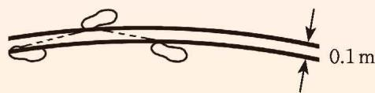

# 有人曾经做过一个很有趣的实验－ 100 名飞行员在草坪上整齐地排列, 把他们的眼睛都蒙起来, 然后叫他们一直向前走。

有人曾经做过一个很有趣的实验: 100 名飞行员在草坪上整齐地排列, 把他们的眼睛都蒙起来, 然后叫他们一直向前走。起初, 他们走得还比较直; 接着一些人渐渐向右偏转, 另一些人向左偏转, 逐渐转起圈来, 最后他们又踏上了自己已走过的路径。实际上, 很久以前人们就已经注意到: 在荒漠中没有携带指南针的旅行家, 也不太能走成直线方向, 而是绕着圆圈打转, 接连多次回到他的出发点。

上面的现象看起来仿佛有点神秘, 其实道理并不复杂。人走路的时候, 只有两腿肌肉工作得完全相同, 他才可以不需要用眼睛就能走成直线。但实际上, 绝大多数人的双腿肌肉发育得并不相同。举例来说, 一位步行者左腿比右腿迈的步子大, 除非用眼睛来帮助修正走路的方向, 否则他就要向右边斜过去, 直至走成两个同心圆 (如图 5-5)。如果这个人两腿走路的时候踏脚线间的距离大约是 $10 \mathrm{~cm}$ , 即 $0.1 \mathrm{~m}$ , 那么当他走完一个圆周 (设圆周的半径为 $R \mathrm{~m}$ ) 时, 他右腿走的路程是 $2 \pi R \mathrm{~m}$ , 左腿走的路程是 $2 \pi (R + 0.1) \mathrm{~m}$ , 二者相差

$$
2 \pi \times 0. 1 = 0. 2 \pi (\mathrm{m}) _ {\circ}
$$

另一方面，如果他行走的平均步长为 $0.7 \mathrm{~m}$ ，那么走完一个圆周所走步数近似等于 $\frac{2 \pi R}{0.7}$ ，即左右腿所走步数都可以近似看作 $\frac{2 \pi R}{2 \times 0.7}$ 。把这个结果乘两腿步长差 $x$ （单位： $\mathrm{m}$ ），就应为两腿走完一个圆周的路程差 $0.2 \pi \mathrm{~m}$ ，即

  
图5-5

$$
\frac {2 \pi R x}{2 \times 0 . 7} = 0. 2 \pi ,
$$

$$
R x = 0. 1 4 _ {\circ}
$$

如果这个人左腿的每一步比右腿的每一步多 0.4 mm，那么蒙上眼睛后他所走圆周的半径满足方程 0.0004R=0.14，因此这一半径大约是 350 m。
