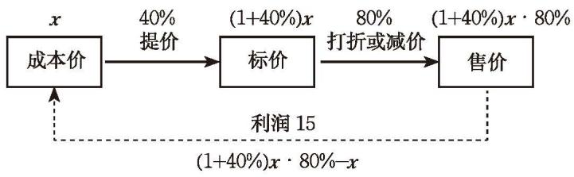

# 写出你的解决方案，并与同伴进行交流。

写出你的解决方案，并与同伴进行交流。

小明用图 5-6 所示的框图直观地表示了商店从进货、标价到销售获利的过程，并将问题中的数量信息标注在框图中。据此，他列出了方程

$$
(1 + 40\%) x \cdot 80\% - x = 15_{\circ}
$$

解这个方程，得 $x = 125$ 。

因此，这种服装每件的成本是 125 元。

  
图5-6
