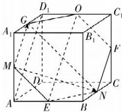

> [!faq]- 答案与解析
>
> > [!success]- **【答案】** 见解析
>
> > [!note]- **【解析】**
> > (1) 连接 NG, 因为 $\overrightarrow{MQ}=x\overrightarrow{MG}+y\overrightarrow{MN}$ $(x,y\in\mathbf{R})$ , 所以点 Q 在平面 MGN 上, 如图, 分别取 $AB, CC_{1}, C_{1}D_{1}$ 的中点 E, F, O, 连接 OG, OF, FN, EN, ME, $AD_{1}, OE$ .
> >
> > 
> >
> > 因为 M, G 分别为 $AA_{1}, A_{1}D_{1}$ 的中点，所以 $MG \parallel AD_{1}$ .
> > 又 $D_{1}O=\frac{1}{2}D_{1}C_{1}, AE=\frac{1}{2}AB, D_{1}C_{1} \parallel AB, D_{1}C_{1}=AB,$ 所以 $D_{1}O \parallel AE$ ，且 $D_{1}O = AE$ ，故四边形 $D_{1}OEA$ 为平行四边形，故 $AD_{1} \parallel OE.$ 故 $MG \parallel OE$ ，故 M, G, O, E 四点共面，同理可证 N, F, O, E 四点共面，E, N, M, F 四点共面，
> > 故 M, G, O, F, N, E 六点共面，由正方体的对称性可得六边形 OFNEMG 为正六边形，
> > 故点 Q 的轨迹是正六边形 OFNEMG.
> > 因为正方体 $ABCD-A_{1}B_{1}C_{1}D_{1}$ 的棱长为 4，所以正六边形 OFNEMG 的边长
> >
> > ## 刷基础
