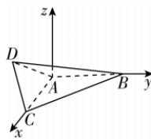

> [!faq]- 答案与解析
>
> > [!success]- **【答案】** D
>
> > [!note]- **【解析】**
> > 设平面 $A_{1}BC_{1}$ 的法向量为 $\boldsymbol{n}=(x,y,z)$ ，则 $\left\{\begin{aligned}\boldsymbol{n}\cdot\overrightarrow{A_{1}B}=y-z=0,\\ \boldsymbol{n}\cdot\overrightarrow{A_{1}C_{1}}=-x+y=0,\end{aligned}\right.$ 令 z=1，可得 x=1,y=1，所以 $\boldsymbol{n}=(1,1,1)$ 。则 $\sin\theta=|\cos\langle\boldsymbol{n},\overrightarrow{DP}\rangle|=\frac{|\boldsymbol{n}\cdot\overrightarrow{DP}|}{|\boldsymbol{n}||\overrightarrow{DP}|}=\frac{|1-\lambda+\lambda+1|}{\sqrt{3}\times\sqrt{(1-\lambda)^{2}+\lambda^{2}+1}}=\frac{2}{\sqrt{6}\times\sqrt{\lambda^{2}-\lambda+1}}$ ，设 $f(\lambda)=\lambda^{2}-\lambda+1,\lambda\in[0,1]$ ，即 $f(\lambda)=\left(\lambda-\frac{1}{2}\right)^{2}+\frac{3}{4},\lambda\in[0,1]$ ，则 $f(\lambda)_{\min}=f\left(\frac{1}{2}\right)=\frac{3}{4};f(\lambda)_{\max}=f(0)=$ 图所示，则 $A(0,0,0),B(0,1,0)$ ， $C(1,0,0)$ .设点 $D$ 的坐标为 $(a,b,$ $c),\overrightarrow{AC} = (1,0,0),\overrightarrow{AD} = (a,b,c)$ .由四边形ABCD及二面角 $B - AC - D$ 为钝角可得 $a > 0,b <   0,c > 0$ 易知 $\pmb {m} =$ $(0,0,1)$ 是平面ABC的法向量，设平面ACD的法向量为 $\pmb {n} = (x,y,$ $z)$ ，则 $\left\{ \begin{array}{l}\overrightarrow{AD}\cdot \pmb {n} = 0,\\ \overrightarrow{AC}\cdot \pmb {n} = 0, \end{array} \right.$ 即 $\left\{ \begin{array}{l}ax + by + cz = 0,\\ x = 0, \end{array} \right.$ 令 $y = c$ ，则 $z = -b$ ， $\pmb {n} = (0,c, - b)$ ∴二面角 $B - AC - D$ 的大小为 $120^{\circ}$ ∴ $|\cos \langle m,n\rangle | = \frac{|m\cdot n|}{|m||n|} = \frac{| - b|}{\sqrt{b^{2} + c^{2}}} =$ $|\cos 120^{\circ}| = \frac{1}{2}$ 得 $c^2 = 3b^2$ ，① $|\overrightarrow{CD}|^2 = (a - 1)^2 +b^2 +c^2 = 1,$ ② $|\overrightarrow{AD}|^2 = a^2 +b^2 +c^2 = (\sqrt{3})^2,$ ③联立①②③，由 $a > 0,b <   0,c > 0$ 得 $a=$ $\frac{3}{2},b = -\frac{\sqrt{3}}{4},c = \frac{3}{4}$ ，即 $D\left(\frac{3}{2},-\frac{\sqrt{3}}{4},\frac{3}{4}\right)$ 点 $D$ 到平面ABC的距离 $d = |\overrightarrow{AD} | \cdot \cos \langle \overrightarrow{AD},m\rangle = \sqrt{3}\times$ $\frac{0 + 0 + \frac{3}{4}}{\sqrt{3}\times 1} = \frac{3}{4}.$ ∵ $S_{\triangle ABC} = \frac{1}{2}\times 1\times 1 = \frac{1}{2},\therefore$ 三棱锥 $D - ABC$ 的体积 $V_{D - ABC} = \frac{1}{3}\times \frac{1}{2}\times$ $\frac{3}{4} = \frac{1}{8}.$
> >
> > 
> >
> > $f(1) = 1$ ，所以 $\sin \theta \in \left[\frac{\sqrt{6}}{3},\frac{2\sqrt{2}}{3}\right]$ 故选D.
