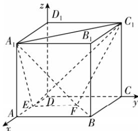

> [!faq]- 答案与解析
>
> > [!success]- **【答案】** 11π
>
> > [!note]- **【解析】**
> > 因为 $\overrightarrow{AE} = \frac{1}{2}\overrightarrow{AD}$ , 所以 $E$ 为 $AD$ 中点. 又 $\overrightarrow{BF} = \lambda \overrightarrow{BA} + \mu \overrightarrow{BC}, \lambda, \mu \in [0,1]$ , 故 $F$ 在底面正方形 $ABCD$ 内 (包括边界), 其中 $S_{\triangle A_1C_1E}$ 为定值, 即三棱锥 $A_1 - FC_1E$ 的体积最大时, 点 $F$ 到平面 $A_1C_1E$ 的距离最大. 以 $D$ 为坐标原点, $DA, DC, DD_1$ 所在直线分别为 $x, y, z$ 轴建立空间直角坐标系, 如图所示. 因为正方体 $ABCD - A_1B_1C_1D_1$ 的棱长为 2 , 所以 $A_1(2,0,2), E(1,0,0), C_1(0,2,2), B(2,2,0)$ , 所以 $\overrightarrow{A_1E} = (-1,0,-2), \overrightarrow{A_1C_1} = (-2,2,0)$ . 设 $F(s,t,0), s,t \in [0,2]$ , 平面 $A_1C_1E$ 的法向量为 $\boldsymbol{m} = (x,y,z)$ , 则 $\left\{ \begin{array}{l} \boldsymbol{m} \cdot \overrightarrow{A_1E} = -x - 2z = 0, \\ \boldsymbol{m} \cdot \overrightarrow{A_1C_1} = -2x + 2y = 0, \end{array} \right.$ 令 $z = 1$ , 得 $x = -2, y = -2$ , 故 $\boldsymbol{m} = (-2,-2,1)$ . 又 $\overrightarrow{EF} = (s-1,t,0)$ , 则点 $F(s,t,0)$ 到平面 $A_1C_1E$ 的距离 $d = \frac{|\overrightarrow{EF} \cdot \boldsymbol{m}|}{|\boldsymbol{m}|} = \frac{|(s-1,t,0) \cdot (-2,-2,1)|}{\sqrt{4+4+1}} = \frac{1}{3} |2 - 2s - 2t|$ ,
> >
> > 故当 s=t=2 时，点 F 到平面 $A_{1}C_{1}E$ 的距离最大，此时 $F(2,2,0)$ ，即 F 与 B 重合.
> > 设三棱锥 $A_{1}-BC_{1}E$ 外接球的球心为 $O(a,b,c)$ ，由 $OE=OB=OA_{1}=OC_{1}$ 得 $\left\{\begin{aligned}(a-1)^{2}+b^{2}+c^{2}&=(a-2)^{2}+(b-2)^{2}+c^{2},\\ (a-1)^{2}+b^{2}+c^{2}&=(a-2)^{2}+b^{2}+(c-2)^{2},\\ (a-1)^{2}+b^{2}+c^{2}&=a^{2}+(b-2)^{2}+(c-2)^{2},\end{aligned}\right.$ 解得 $a=b=c=\frac{7}{6}$ ,
> > 故外接球球心 $O\left(\frac{7}{6},\frac{7}{6},\frac{7}{6}\right)$ ，半径 $r=\sqrt{\left(\frac{7}{6}-1\right)^{2}+\left(\frac{7}{6}\right)^{2}+\left(\frac{7}{6}\right)^{2}}=\frac{\sqrt{11}}{2}$ 故外接球的表面积为 $4\pi r^{2}=11\pi$ .
> >
> > 
> >
> > 名师点拨 几何体外接球问题,通常要找到几何体的一个特殊平面,利用几何性质找到其外接圆的圆心,求出外接圆的半径,进而找到外接球的球心的位置,求出外接球的半径,也可以利用空间向量的方法,设出球心坐标,利用待定系数法进行求解.
