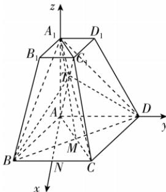

> [!faq]- 答案与解析
>
> > [!success]- **【答案】** 证明见解析
>
> > [!note]- **【解析】**
> > (2) 取 BC 的中点 N, 可以得到以 A 为原点, AN, AD, $AA_{1}$ 所在直线分别为 x, y, z 轴建立的空间直角坐标系, 根据 $\triangle A_{1}C_{1}T \sim \triangle CAT$ 得到 $\frac{A_{1}T}{CT} = \frac{1}{2}$ , 从而得到 $\overrightarrow{A_{1}C} = 3\overrightarrow{A_{1}T}$ , 利用向量的坐标运算求出点 T 的坐标, 从而求出平面 TBD 的法向量 n, 利用向量数量积的坐标运算得到直线 $AA_{1}$ 与平面 TBD 所成角的正弦值.
> >
> > (1)【证明】如图, 连接 $A_{1}C_{1}, AC$ , 记 $AC \cap BD = M$ , 连接 $A_{1}M, \because AB = AA_{1} = 2A_{1}B_{1} = 2$ , 底面四边形 ABCD 为菱形, $\angle ABC = \frac{\pi}{3}, \therefore AC = 2, A_{1}C_{1} = 1$ .
> >
> > ∵ 底面四边形 ABCD 为菱形, ∴ M 为 AC 的中点, ∴ MC = 1, ∴ $A_{1}C_{1} = MC$ . 又由棱台的结构特征知 $MC // A_{1}C_{1}, \therefore$ 四边形 $A_{1}C_{1}CM$ 为平行四边形, ∴ $A_{1}M // C_{1}C$ .
> >
> > ∵ $A_{1}M \subset$ 平面 $A_{1}BD, CC_{1} \not\subset$ 平面 $A_{1}BD, \therefore CC_{1} //$ 平面 $A_{1}BD.$ → 敬黑板: 证明线面平行时要说明直
> >
> > 敲黑板：证明线面平行时要说明直线不在平面内
> >
> > 
> >
> > (2)【解】∵底面四边形ABCD为菱形， $\angle ABC=\frac{\pi}{3}$ ，∴△ABC是等边三角形，取BC的中点N，连接AN，则 $AN\perp BC$ ∵ $BC \parallel AD$ ，∴ $AN \perp AD$ ，∵ $AA_{1} \perp$ 平面ABCD，∴以A为原点，AN, AD, $AA_{1}$ 所在直线分别为x,y,z轴建立空间直角坐标系，如图所示，
> > ∴ $A(0,0,0)$ , $A_{1}(0,0,2)$ , $C(\sqrt{3},1,0)$ , $B(\sqrt{3},-1,0)$ , $D(0,2,0)$ ,
> > ∵ $A_{1}C_{1} // AC, AC_{1} \cap A_{1}C = T$ ,
> > ∴ $\triangle A_{1}C_{1}T \sim \triangle CAT$ , ∴ $\frac{A_{1}T}{CT} = \frac{A_{1}C_{1}}{CA} = \frac{1}{2}$ , ∴ $\overrightarrow{A_{1}C} = 3\overrightarrow{A_{1}T}$ .
> > 设 $T(x_{0},y_{0},z_{0})$ ，则 $\overrightarrow{A_{1}T}=(x_{0},y_{0},z_{0}-2)$ ，又 $\overrightarrow{A_{1}C}=(\sqrt{3},1,-2),\overrightarrow{A_{1}C}=3\overrightarrow{A_{1}T},\therefore(\sqrt{3},1,-2)=3(x_{0},y_{0},z_{0}-2),\therefore T\left(\frac{\sqrt{3}}{3},\frac{1}{3},\frac{4}{3}\right)$ .
> > 又∵ $B(\sqrt{3},-1,0)$ , $D(0,2,0)$ , ∴ $\overrightarrow{BD}=(-\sqrt{3},3,0),\overrightarrow{BT}=\left(-\frac{2\sqrt{3}}{3},\frac{4}{3},\frac{4}{3}\right)$ .
> > 设平面 TBD 的法向量为 $n=(x,y,z)$ ,
> > ∵ $\left\{\begin{aligned}&n\cdot\overrightarrow{BD}=0,\\&n\cdot\overrightarrow{BT}=0,\end{aligned}\right.$ ∴ $\left\{\begin{aligned}-\sqrt{3}x+3y=0,\\-\frac{2\sqrt{3}}{3}x+\frac{4}{3}y+\frac{4}{3}z=0,\end{aligned}\right.$ 取 $x=\sqrt{3}$ ，解得 y=1,z= $\frac{1}{2}$ ，则 $n=\left(\sqrt{3},1,\frac{1}{2}\right)$ ，则 $|n|=\sqrt{1+3+\frac{1}{4}}=\frac{\sqrt{17}}{2}.$ ∵ $A(0,0,0)$ , $A_{1}(0,0,2)$ , ∴ $\overrightarrow{AA_{1}}=(0,0,2),|\overrightarrow{AA_{1}}|=2.$ 设直线 $AA_{1}$ 与平面 TBD 所成的角为 $\alpha$ ,
> > 则 $\sin\alpha=|\cos\langle n,\overrightarrow{AA_{1}}\rangle|=\frac{|n\cdot\overrightarrow{AA_{1}}|}{|n||\overrightarrow{AA_{1}}|}=$ 地坑：线面所成角的正弦值即为直线的方向向量与平面法向量夹角余弦值的绝对值 $\frac{\frac{1}{2}\times2}{\frac{\sqrt{17}}{2}\times2}=\frac{\sqrt{17}}{17}$ ，∴ 直线 $AA_{1}$ 与平面 TBD 所成角的正弦值为 $\frac{\sqrt{17}}{17}$ .
