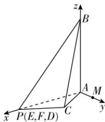

> [!faq]- 答案与解析
>
> > [!success]- **【答案】** 见解析
>
> > [!note]- **【解析】**
> > (1)在 $\triangle ABD$ 中,因为 $AB=AD=\sqrt{3},AB\perp AD$ ,所以 $BD=\sqrt{6}$ ,所以 $FB=BD=\sqrt{6}$ .
> >
> > 在 $\triangle ACE$ 中,因为 $AE=AD=\sqrt{3},AC=1,\angle CAE=30^{\circ}$ ,所以 $CE=\sqrt{(\sqrt{3})^{2}+1^{2}-2\times\sqrt{3}\times1\times\cos30^{\circ}}=1$ ,所以 $CF=CE=1$ .
> >
> > 又因为 $BC=\sqrt{AC^{2}+AB^{2}}=\sqrt{1^{2}+(\sqrt{3})^{2}}=2$ ,
> >
> > 在 $\triangle FCB$ 中,由余弦定理得 $\cos\angle FCB=\frac{CF^{2}+BC^{2}-FB^{2}}{2\cdot CF\cdot BC}=\frac{1^{2}+2^{2}-(\sqrt{6})^{2}}{2\times1\times2}=-\frac{1}{4}$ ,
> >
> > 所以 $\angle FCB$ 的余弦值为- $\frac{1}{4}$ .
> >
> > (2)由 $AB\perp AD$ ,知 $AB\perp AP$ ,又 $AB\perp AC,AC\cap AP=A,AC,AP\subset$ 平面 $ACP$ ,所以 $AB\perp$ 平面 $ACP$ ,在平面 $ACP$ 内作 $AM\perp AP$ ,
> >
> > 以 $A$ 为坐标原点, $AP,AM,AB$ 所在直线分别为 $x,y,z$ 轴,建立如图所示的空间直角坐标系,
> >
> > 
> >
> > 则 $P(\sqrt{3},0,0)$ ， $B(0,0,\sqrt{3})$ ， $C\left(\frac{\sqrt{3}}{2},\frac{1}{2},0\right)$ ，设 $Q(a,0,0)(0<a<\sqrt{3})$ ，故 $\overrightarrow{BQ}=(a,0,-\sqrt{3})$ ， $\overrightarrow{BC}=\left(\frac{\sqrt{3}}{2},\frac{1}{2},-\sqrt{3}\right)$ ，
> > 设平面 BCQ 的法向量为 $\boldsymbol{m}=(x,y,z)$ ，
> > 则 $\left\{\begin{aligned}&\boldsymbol{m}\cdot\overrightarrow{BQ}=ax-\sqrt{3}z=0,\\ &\boldsymbol{m}\cdot\overrightarrow{BC}=\frac{\sqrt{3}}{2}x+\frac{1}{2}y-\sqrt{3}z=0,\end{aligned}\right.$ 令 z=
> >
> > ## 刷难关
