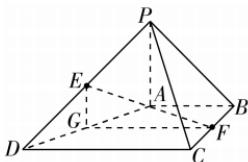
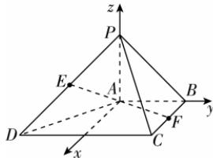

> [!faq]- 答案与解析
>
> > [!success]- **【答案】** 见解析
>
> > [!note]- **【解析】**
> > 如图，
> >
> > 
> >
> > 过点 E 作 $EG \perp AD$ 交 AD 于点 G，连接 GF.
> > 因为 PA ⊥ 平面 ABCD, AD ⊂ 平面 ABCD, 所以 PA ⊥ AD, 又 EG ⊂ 平面 PAD, PA ⊂ 平面 PAD, 故 EG // PA.
> > 因为 E 为 PD 的中点, 所以 G 也为 AD 的中点. 又 F 为 BC 的中点, AB // CD, 所以 GF // AB.
> > 因为 $EG \not\subset$ 平面 PAB, $PA \subset$ 平面
> >
> > PAB, 所以 $EG \parallel$ 平面 $PAB$ , 同理 $GF \parallel$ 平面 $PAB$ , 又 $EG \cap GF = G, EG, GF \subset$ 平面 $EGF$ , 所以平面 $EGF \parallel$ 平面 $PAB$ , 而 $EF \subset$ 平面 $EGF$ , 所以 $EF \parallel$ 平面 $PAB$ .
> >
> > (2)【解】存在点 $M$ 满足题意, 此时 $\frac{DM}{DP} = \frac{1}{2}$ . 根据题意设 $DM = tPD (0 \leqslant t < 1)$ , 如图, 以点 $A$ 为原点, 过点 $A$ 在平面 $ABCD$ 内作垂直于 $AB$ 的直线为 $x$ 轴, $AB, AP$ 所在的直线分别为 $y, z$ 轴建立空间直角坐标系.
> >
> > 
> >
> > 则 $P(0,0,1)$ , $B(0,1,0)$ , $C(2\sqrt{2},1,0)$ , $D(2\sqrt{2},-1,0)$ .
> > 故 $\overrightarrow{PB}=(0,1,-1),\overrightarrow{PC}=(2\sqrt{2},1,-1),\overrightarrow{PD}=(2\sqrt{2},-1,-1),\overrightarrow{CD}=(0,-2,0)$ ，则 $\overrightarrow{CM}=\overrightarrow{CD}+\overrightarrow{DM}=\overrightarrow{CD}-t\overrightarrow{PD}=(-2\sqrt{2}t,t-2,t)$ .
> > 避坑： $\overrightarrow{DM}=-t\overrightarrow{PD}$ ，勿忽略负号
> > 设平面PBC的法向量为 $n=(x,y,z)$ ，则有 $\left\{\begin{aligned}\boldsymbol{n}\cdot\overrightarrow{PB}&=y-z=0,\\ \boldsymbol{n}\cdot\overrightarrow{PC}&=2\sqrt{2}x+y-z=0,\end{aligned}\right.$ 取 y=1，可得 $n=(0,1,1)$ .
> > 则 $\left|\cos\left\langle n,\overrightarrow{CM}\right\rangle\right|=\frac{\left|\boldsymbol{n}\cdot\overrightarrow{CM}\right|}{\left|\boldsymbol{n}\right|\left|\overrightarrow{CM}\right|}=\frac{\left|2t-2\right|}{\sqrt{2}\times\sqrt{\left(-2\sqrt{2}t\right)^{2}+\left(t-2\right)^{2}+t^{2}}}=\frac{1}{3}$ 整理得 $4t^{2}-16t+7=0$ ，解得 $t=\frac{1}{2}$ 或 $\frac{7}{2}$ （舍去），
> > 所以当 $\frac{DM}{DP}=\frac{1}{2}$ 时，直线CM与平面PBC所成角的正弦值是 $\frac{1}{3}$ .
> > (3)【解】存在点H满足题意，此时点H的轨迹是半径为 $\frac{3\sqrt{2}}{4}$ 的圆。由(2)知，平面PBC的一个法向量为n=(0,1,1)，点B(0,1,0)，AD的中点G $\left(\sqrt{2},-\frac{1}{2},0\right)$ ，则 $\overrightarrow{BG}=\left(\sqrt{2},-\frac{3}{2},0\right)$ ，则点G到平面PBC的距离为 $\frac{\left|\overrightarrow{BG}\cdot n\right|}{\left|n\right|}=$ $\frac{\left|0\times\sqrt{2}+1\times\left(-\frac{3}{2}\right)+1\times0\right|}{\sqrt{1+1}}=\frac{\left|- \frac{3}{2}\right|}{\sqrt{2}}=$ $\frac{3\sqrt{2}}{4}$ . 由 $\overrightarrow{HD} \cdot \overrightarrow{HA} = 0$ , 得 $HD \perp HA$ , 故 H 在以 AD 的中点为球心, 半径为 $\frac{1}{2}AD = \frac{3}{2}$ 的球面上,
> >
> > ## 刷真题
