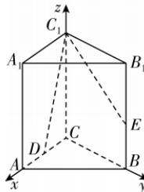

> [!faq]- 答案与解析
>
> > [!success]- **【答案】** A
>
> > [!note]- **【解析】**
> > 因为 $CC_{1} \perp$ 平面 ABC, CA, CB ⊂ 平面 ABC, 所以 $CC_{1} \perp CA$ , $CC_{1} \perp CB$ . 又 $\angle ACB = \frac{\pi}{2}$ , 所以 CA, CB, $CC_{1}$ 两两垂直,
> > 以 C 为原点, CA, CB, $CC_{1}$ 所在直线分别为 x, y, z 轴建立如图所示的空间直角坐标系,
> >
> > 
> >
> > 连接 $C_{1}D$ ，则 $D(1,0,0)$ ， $C_{1}(0,0,2)$ ，设 $E(0,1,c)$ ，其中 $0 \leqslant c \leqslant 2$ ，
> > 所以 $\overrightarrow{C_{1}D}=(1,0,-2),\overrightarrow{C_{1}E}=(0,1,c-2)$ 则点 D 到直线 $C_{1}E$ 的距离 $d=\sqrt{|\overrightarrow{C_{1}D}|^{2}-\left(\frac{\overrightarrow{C_{1}D}\cdot\overrightarrow{C_{1}E}}{|\overrightarrow{C_{1}E}|}\right)^{2}}$ $=\sqrt{5-\left[\frac{-2(c-2)}{\sqrt{(c-2)^{2}+1}}\right]^{2}}$ $=\sqrt{5-\frac{4(c-2)^{2}}{(c-2)^{2}+1}}$ , 设 $t=(c-2)^{2}+1$ , 因
> > 点悟：运用换元法，易于求 d 的范围
> > 为 $c \in [0, 2]$ ，所以 $t \in [1, 5]$ ，则 $d = \sqrt{1 + \frac{4}{t}} \in \left[\frac{3\sqrt{5}}{5}, \sqrt{5}\right]$ .
> > 所以点 D 到直线 $C_{1}E$ 的距离的最小值为 $\frac{3\sqrt{5}}{5}$ ，故选 A.
