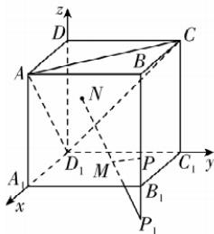

> [!faq]- 答案与解析
>
> > [!success]- **【答案】** $3\sqrt{3}$
>
> > [!note]- **【解析】**
> > 取点 P 关于平面 $A_{1}B_{1}C_{1}D_{1}$ 的对称点为 $P_{1}$ ,
> > 巧思：求折线长度最值问题，首先考虑用对称转化线段
> > 则 $PM = P_{1}M$ ，设点 $P_{1}$ 到平面 $ACD_{1}$ 的距离为 d，则 $PM + MN = P_{1}M + MN \geqslant d$ .
> > 以 $D_{1}$ 为原点， $D_{1}A_{1}, D_{1}C_{1}, D_{1}D$ 所在直线分别为 x 轴、y 轴、z 轴建立如图所示的空间直角坐标系，
> > 因为正方体的棱长为4，且 $\overrightarrow{BP} = 3\overrightarrow{PB_{1}}$ ，所以 $P_{1}(4,4,-1), A(4,0,4), C(0,4,4), D_{1}(0,0,0)$ ，
> > 所以 $\overrightarrow{D_{1}P_{1}}=(4,4,-1),\overrightarrow{D_{1}A}=(4,0,4),\overrightarrow{D_{1}C}=(0,4,4)$ .
> > 设平面 $ACD_{1}$ 的法向量为 $m=(x,y,z)$ ，则 $\left\{\begin{aligned}\overrightarrow{D_{1}A}\cdot\boldsymbol{m}&=4x+4z=0,\\ \overrightarrow{D_{1}C}\cdot\boldsymbol{m}&=4y+4z=0,\end{aligned}\right.$ 取 x = 1，则 y = 1, z = -1，则 $m = (1, 1, -1)$ ，所以点 $P_{1}$ 到平面 $ACD_{1}$ 的距离 $d=\frac{|\overrightarrow{D_{1}P_{1}}\cdot\boldsymbol{m}|}{|\boldsymbol{m}|}=\frac{|4+4+1|}{\sqrt{1+1+1}}=\frac{9}{\sqrt{3}}=3\sqrt{3}$ . 即 $PM+MN$ 的最小值为 $3\sqrt{3}$ .
> >
> > 
> >
> > 归纳总结 处理空间几何体中的距离之和的最值问题的方法
> > (1)借助参数表达,转化为函数最值求解;
> > (2)利用展开图,将空间距离之和转化为平面距离之和,再利用两点之间线段最短求解;
> > (3)借助对称,化线(面)的同侧为线(面)的异侧,转化为两点间的距离(点面距)求解.
