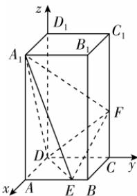
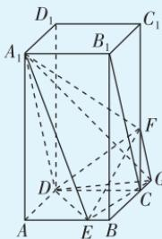

> [!faq]- 答案与解析
>
> > [!success]- **【答案】** $\left(\frac{1}{3}, \frac{1}{2}\right)$
>
> > [!note]- **【解析】**
> > 以 $D$ 为坐标原点，分别以直线 $DA, DC, DD_{1}$ 为 $x, y, z$ 轴建立空间直角坐标系 $Dxyz$ ，如图所示.
> >
> > 
> >
> > 设 $E(1,m,0)(0 < m < 1)$ 则 $F(0,1,m)$ ，又 $D(0,0,0),A_1(1,0,2)$ ，所以 $\overrightarrow{DE} = (1,m,0),\overrightarrow{DF} = (0,1,m),\overrightarrow{DA_1} = (1,0,2)$ 设平面DEF的法向量为 $\pmb {n} = (x,y,z)$ 则 $\left\{ \begin{array}{l}\overrightarrow{DE}\cdot \pmb {n} = 0,\\ \overrightarrow{DF}\cdot \pmb {n} = 0, \end{array} \right.$ 即 $\left\{ \begin{array}{l}x + my = 0,\\ y + mz = 0, \end{array} \right.$ 令 $z = -1$ ，则 $y = m,x = -m^2$ 所以平面DEF的一个法向量为 $\pmb {n} = (-m^2,m, - 1)$ 点 $A_{1}$ 到平面DEF的距离 $d = \frac{|\overrightarrow{DA_1}\cdot\pmb{n}|}{|\pmb{n}|} = \frac{m^2 + 2}{\sqrt{m^4 + m^2 + 1}}.$ 设△DEF中的EF边上的高为h，因为 $DE = DF = \sqrt{1 + m^2},$ $EF = \sqrt{2(m^2 - m + 1)}$ 所以 $h = \sqrt{DE^2 - \left(\frac{EF}{2}\right)^2} =$ $\sqrt{\frac{m^2 + m + 1}{2}}$ ，所以 $S_{\triangle DEF} = \frac{1}{2} EF\cdot h =$ $\frac{1}{2}\sqrt{2(m^2 - m + 1)}\cdot \sqrt{\frac{m^2 + m + 1}{2}} =$ $\frac{1}{2}\sqrt{m^4 + m^2 + 1},$ 所以 $V_{A_1 - DEF} = \frac{1}{3} S_{\triangle DEF}\cdot d = \frac{m^2 + 2}{6}(0 <   m <   1)$ 所以三棱锥 $A_{1}$ -DEF的体积的取值范围是 $\left(\frac{1}{3},\frac{1}{2}\right)$
> >
> > 多种解法（此法作辅助线比较难）设 $AE = CF = x(0 < x < 1)$ ，延长 $BC$ 到 $G$ ，使得 $CG = \frac{x}{2}$ ，连接 $FG, B_1C$ ，则 $\tan \angle CFG = \frac{CG}{CF} = \frac{1}{2}, \tan \angle C_1CB_1 = \frac{B_1C_1}{CC_1} = \frac{1}{2}$ ，则 $\angle CFG = \angle C_1CB_1$ ，于是 $FG // B_1C$ . 因为长方体 $ABCD - A_1B_1C_1D_1$ 的对角面 $A_1B_1CD$ 是矩形，所以 $A_1D // B_1C // FG$ ，又 $A_1D \subset$ 平面 $A_1DE, FG \not\subset$ 平面 $A_1DE$ ，于是 $FG //$ 平面 $A_1DE$ ，所以点 $F$ 到平面 $A_1DE$ 的距离等于点 $G$ 到平面 $A_1DE$ 的距离，连接 $GA_1, GD, GE$ ，由等体积法可知 $V_{A_1-DEF} = V_{F-A_1DE} = V_{G-A_1DE} = V_{A_1-DEG} = \frac{1}{3} AA_1 \cdot S_{\triangle DEG} = \frac{2}{3} \cdot S_{\triangle DEG}$ ，又 $S_{\triangle DEG} = S_{\text{梯形}ABGD} - S_{\triangle ADE} - S_{\triangle BGE} = \frac{(1 + 1 + \frac{x}{2}) \times 1}{2} - \frac{1 \times x}{2} - \frac{(1 - x)(1 + \frac{x}{2})}{2} = \frac{1}{2} + \frac{x^2}{4}$ ，故 $\frac{1}{2} < S_{\triangle DEG} < \frac{3}{4}$ ，所以 $V_{A_1-DEF} \in \left(\frac{1}{3}, \frac{1}{2}\right)$ .
> >
> > 
