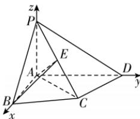

> [!faq]- 答案与解析
>
> > [!success]- **【答案】** .
>
> > [!note]- **【解析】**
> > （1）由线面角得到 $\angle PCA = 45^{\circ}$ ，故 $AE \perp PC$ ，证明出 $AE \perp$ 平面 PCD，得到 $AE \perp PD$ ，再由 $AB \perp AD, AB \perp PA$ ，证明出 $AB \perp$ 平面 PAD，得到 $AB \perp PD$ ，从而证出 $PD \perp$ 平面 ABE；
> > (2)证明出AB,AD,PA两两垂直,建立空间直角坐标系,求出平面PCD的法向量,利用点到平面距离的向量公式求出答案.
> >
> > (1)【证明】∵ PA ⊥ 平面 ABCD, PC 与平面 ABCD 所成角为 $45^{\circ}$ ,
> > ∴ PA ⊥ AC, ∠PCA = $45^{\circ}$ , ∴ PA = AC.
> > 又 E 为 PC 的中点, ∴ AE ⊥ PC.
> > ∵ PA ⊥ 平面 ABCD, AB, CD ⊂ 平面
> > ABCD, ∴ PA ⊥ AB, PA ⊥ CD.
> > ∵ AC ⊥ CD, PA ∩ AC = A, PA, AC ⊂ 平面
> > PAC, ∴ CD ⊥ 平面 PAC.
> >
> > ∵ $AE \subset$ 平面 PAC, ∴ $AE \perp CD$ .
> > 又 $PC \cap CD = C, PC, CD \subset$ 平面 $PCD, \therefore AE \perp$ 平面 $PCD.$ ∵ $PD \subset$ 平面 $PCD, \therefore AE \perp PD.$ ∵ $AB \perp AD, AB \perp PA, PA \cap AD = A, PA, AD \subset$ 平面 PAD, ∴ $AB \perp$ 平面 PAD.
> > ∵ $PD \subset$ 平面 PAD, ∴ $AB \perp PD.$ 又 $AB \cap AE = A, AB, AE \subset$ 平面 ABE,
> > ∴ $PD \perp$ 平面 ABE.
> > (2)【解】∵ PA ⊥ 平面 ABCD, AB, AD ⊂
> > 平面 ABCD, ∴ PA ⊥ AB, PA ⊥ AD.
> > 又 AB ⊥ AD, ∴ AB, AD, PA 两两垂直，以 A 为原点，AB, AD, AP 所在直线分别为 x 轴、y 轴、z 轴建立如图所示的空间直角坐标系，
> > ∵ AB ⊥ AD, △ABC 为等边三角形，
> > ∴ $\angle CAD = 30^{\circ}$ ,
> > ∵ $CD = \sqrt{3}, AC \perp CD, \therefore AC = 3, AD = 2\sqrt{3}$ ,
> > 则 B(3,0,0), P(0,0,3), C( $\frac{3}{2}, \frac{3\sqrt{3}}{2}, 0$ ), D(0,2 $\sqrt{3}$ ,0), ∴ $\overrightarrow{DP} = (0, -2\sqrt{3}, 3)$ , $\overrightarrow{DC} = \left(\frac{3}{2}, -\frac{\sqrt{3}}{2}, 0\right)$ ,
> > 设平面 PCD 的法向量为 $n = (x, y, z)$ ,
> > ∴ $\left\{\begin{aligned}\overrightarrow{DP} &\cdot n=0,\\ \overrightarrow{DC} &\cdot n=0,\end{aligned}\right.$ 则 $\left\{\begin{aligned}-2\sqrt{3}y+3z=0,\\ \frac{3}{2}x-\frac{\sqrt{3}}{2}y=0,\end{aligned}\right.$ 即 $\left\{\begin{aligned}y=\frac{\sqrt{3}}{2}z,\\ y=\sqrt{3}x.\end{aligned}\right.$ 取 $y=\sqrt{3}$ ，则 x=1,z=2，
> > ∴ $n=(1,\sqrt{3},2)$ .
> > ∵ $\overrightarrow{BP}=(-3,0,3)$ , ∴ 点 B 到平面 PCD 的距离 $d=\frac{|\overrightarrow{BP} \cdot n|}{|n|}=\frac{|-3+0+6|}{\sqrt{1+3+4}}=\frac{3\sqrt{2}}{4}$ .
> >
> > 
> >
> > ## 刷素养
