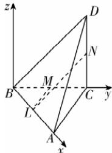

> [!faq]- 答案与解析
>
> > [!success]- **【答案】** $\frac{\sqrt{2}}{4}$
>
> > [!note]- **【解析】**
> > 由题意知,AB,BC,CD两两垂直,则以B为原点,BA,BC所在直线分别为x轴,y轴,过点B且与CD平行的直线为z轴,建立如图所示空间直角坐标系.
> >
> > 
> >
> > 连接 LM，则 $L\left(\frac{1}{2},0,0\right)$ ， $M\left(0,\frac{1}{2},0\right)$ ， $N\left(0,1,\frac{1}{2}\right)$ ，所以 $\overrightarrow{LM}=\left(-\frac{1}{2},\frac{1}{2},0\right)$ ， $\overrightarrow{LN}=\left(-\frac{1}{2},1,\frac{1}{2}\right)$ ，所以点 M 到直线 LN 的距离为 $d=\sqrt{|\overrightarrow{LM}|^{2}-\left(\frac{\overrightarrow{LM}\cdot\overrightarrow{LN}}{|\overrightarrow{LN}|}\right)^{2}}=\frac{\sqrt{2}}{4}$ .
> >
> > ## 课时 2 用空间向量研究夹角问题
