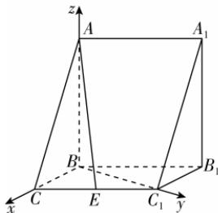

> [!faq]- 答案与解析
>
> > [!success]- **【答案】** 见解析
>
> > [!note]- **【解析】**
> > 在 $\triangle BCC_{1}$ 中，已知 $\angle BCC_{1} = \frac{\pi}{3},BC = 1,C_{1}C = 2,$ 由余弦定理得 $C_1B^2 = BC^2 +C_1C^2 -$ $2BC\cdot C_1C\cdot \cos \frac{\pi}{3} = 3 = C_1C^2 -$ $BC^2$ ，所以 $BC_{1}\bot BC.$ 因为 $AB\bot$ 平面 $BB_{1}C_{1}C,BC_{1}\subset$ 平面 $BB_{1}C_{1}C,$ 所以 $AB\bot BC_{1}$ .又 $AB\cap BC = B,AB,BC\subset$ 平面ABC，所以 $BC_{1}\bot$ 平面ABC.(2)【解】由(1)可知BA，BC， $BC_{1}$ 两两垂直，所以以 $B$ 为原点，建立如图所示的空间直角坐标系
> >
> > 
> >
> > 则 $B(0,0,0)$ , $A(0,0,2)$ , $E\left(\frac{1}{2}, \frac{\sqrt{3}}{2}, 0\right)$ , $C_{1}(0, \sqrt{3}, 0)$ ，所以 $\overrightarrow{BC_{1}} = (0, \sqrt{3}, 0)$ , $\overrightarrow{AE} = \left(\frac{1}{2}, \frac{\sqrt{3}}{2}, -2\right)$ ，所以 $\cos\left\langle\overrightarrow{BC_{1}},\overrightarrow{AE}\right\rangle=\frac{\overrightarrow{BC_{1}}\cdot\overrightarrow{AE}}{\left|\overrightarrow{BC_{1}}\right|\left|\overrightarrow{AE}\right|}=$ $\frac{\frac{3}{2}}{\sqrt{3}\times\sqrt{5}}=\frac{\sqrt{15}}{10}$ 所以异面直线 $BC_{1}$ 与 AE 所成角的余弦值为 $\frac{\sqrt{15}}{10}$ .
