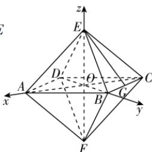

> [!faq]- 答案与解析
>
> > [!success]- **【答案】** A
>
> > [!note]- **【解析】**
> > 连接 AC 交 BD 于点 O，连接 EF。因为该几何体是一个高为 4 的正八面体，所以 EF 过点 O，且 $BD \perp AC, EF = 4$ ，则 OE = 2。
> > 设正八面体的棱长为 a，则 $AC = \sqrt{2}a$ ， $OA = \frac{\sqrt{2}a}{2}$ ，所以在 Rt $\triangle AOE$ 中， $AE^{2} = OA^{2} + OE^{2}$ ，即 $a^{2} = \left(\frac{\sqrt{2}a}{2}\right)^{2} + 2^{2}$ ，解得 $a = 2\sqrt{2}$ 。
> >
> > 以 O 为原点, OA, OB, OE 所在直线分别为 x, y, z 轴, 建立如图所示的空间直角坐标系. 则 E(0, 0,
> >
> > 
> >
> > 2), $G(-1,1,0)$ ，所以 $\overrightarrow{EG}=(-1,1,-2)$ 。易知平面 BDE 的一个法向量为 $\boldsymbol{n}=(1,0,0)$ 。设直线 EG 与平面 BDE 所成的角为 $\theta$ ，所以 $\sin\theta=|\cos\langle\overrightarrow{EG},\boldsymbol{n}\rangle|=\frac{|\overrightarrow{EG}\cdot\boldsymbol{n}|}{|\overrightarrow{EG}||\boldsymbol{n}|}=\frac{1}{\sqrt{6}}=\frac{\sqrt{6}}{6}$ .
> >
> > 避坑：注意线面角与直线方向向量和平面法向量夹角间的转化故选A.
