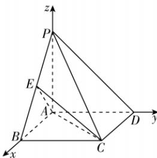

> [!faq]- 答案与解析
>
> > [!success]- **【答案】** 见解析
>
> > [!note]- **【解析】**
> > 因为 $PA \perp$ 底面ABCD， $AB, AD \subset$ 平面ABCD，所以 $PA \perp AB, PA \perp AD$ ，又底面ABCD为矩形，故 $AB \perp AD$ ，所以 $AB, AD, AP$ 两两垂直，故以 $A$ 为原点， $\overrightarrow{AB}, \overrightarrow{AD}, \overrightarrow{AP}$ 的方向分别为 $x, y, z$ 轴的正方向，建立空间直角坐标系，如图.
> >
> > 
> >
> > 由题意得, $AB = AD = 2, PD = 2\sqrt{2}$ , 则 $PA = \sqrt{PD^2 - AD^2} = 2$ , 则 $A(0,0,0)$ , $D(0,2,0), P(0,0,2), C(2,2,0)$ , $B(2,0,0)$ , 所以 $\overrightarrow{PB} = (2,0,-2), \overrightarrow{DP} = (0,-2,2)$ . 设 $E(a,0,c)$ , 则 $\overrightarrow{PE} = (a,0,c-2)$ , 又点 $E$ 在棱 $PB$ 上, 则设 $\overrightarrow{PE} = \lambda \overrightarrow{PB} = (2\lambda,0,-2\lambda) (0 \leqslant \lambda \leqslant 1)$ , 即 $(a,0,c-2) = (2\lambda,0,-2\lambda)$ , 解得 $a = 2\lambda, c = 2-2\lambda$ , 则 $E(2\lambda,0,2-2\lambda)$ , 可得 $\overrightarrow{CE} = (2\lambda-2,-2,2-2\lambda)$ . 由题意可得 $|\cos \langle \overrightarrow{DP}, \overrightarrow{CE} \rangle| = |\overrightarrow{DP} \cdot \overrightarrow{CE}|$ = $\frac{|8-4\lambda|}{|\overrightarrow{DP}| |\overrightarrow{CE}|} = \frac{18-4\lambda|}{2\sqrt{2} \cdot \sqrt{2(2\lambda-2)^2+4}} = \cos \frac{\pi}{6} = \frac{\sqrt{3}}{2}$ , 整理可得 $4\lambda^2 - 4\lambda + 1 = 0$ , 解得 $\lambda = \frac{1}{2}$ , 所以点 $E$ 为棱 $PB$ 的中点. (2)【解】由 (1) 可得 $\overrightarrow{CD} = (-2,0,0), \overrightarrow{AC} = (2,2,0), \overrightarrow{AE} = (1,0,1)$ . 设平面 $ACE$ 的法向量为 $n = (x,y,z)$ , 则 $\left\{ \begin{array}{l} \overrightarrow{AC} \cdot n = 2x + 2y = 0, \\ \overrightarrow{AE} \cdot n = x + z = 0, \end{array} \right.$ 令 $x = 1$ 可得 $n = (1,-1,-1)$ . 设直线 $CD$ 与平面 $ACE$ 所成角为 $\theta$ , 则 $\sin \theta = |\cos \langle n, \overrightarrow{CD} \rangle| = \frac{|n \cdot \overrightarrow{CD}|}{|n||\overrightarrow{CD}|} = \frac{2}{2\times\sqrt{3}} = \frac{\sqrt{3}}{3}$ , 所以直线 $CD$ 与平面 $ACE$ 所成角的正弦值为 $\frac{\sqrt{3}}{3}$ .
> >
> > 归纳总结 求空间角的常用方法
> > (1) 定义法: 由异面直线所成角、线面角、二面角的定义, 结合图形, 作出所求空间角, 再结合题中条件, 解对应三角形, 即可求出结果;
> > (2) 向量法: 建立适当的空间直角坐标系, 通过计算向量夹角 (直线方向向量与直线方向向量、直线方向向量与平面法向量、平面法向量与平面法向量) 的余弦值, 再进行转化求出结果.
