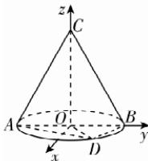

> [!faq]- 答案与解析
>
> > [!success]- **【答案】** A
>
> > [!note]- **【解析】**
> > 因为 $\angle AOD = 2\angle BOD$ ，且 $\angle AOD + \angle BOD = \pi$ ，所以 $\angle BOD = \frac{\pi}{3}$ 。连接 BD, CO，则 $CO \perp$ 平面 ABD，以点 O 为坐标原点，平面 ABD 内过点 O 且垂直于 OB 的直线为 x 轴，OB, OC 所
> >
> > 在直线分别为 $y, z$ 轴，建立如图所示的空间直角坐标系. 设圆 $O$ 的半径为2，则 $A(0, -2,$
> >
> > 
> >
> > $$
> > B (0, 2, 0)
> > $$
> >
> > $C(0,0,2\sqrt{3}),D(\sqrt{3},1,0)$ ，所以 $\overrightarrow{AD} =$ $(\sqrt{3},3,0),\overrightarrow{BC} = (0, - 2,2\sqrt{3})$ .设异面直线 $AD$ 与 $BC$ 所成的角为 $\theta$ ，则 $\cos \theta =$ $|\cos \langle \overrightarrow{AD},\overrightarrow{BC}\rangle | = \frac{|\overrightarrow{AD}\cdot\overrightarrow{BC}|}{|\overrightarrow{AD}||\overrightarrow{BC}|} = \frac{| - 6|}{2\sqrt{3}\times 4} =$ $\frac{\sqrt{3}}{4}$ ，因此异面直线 $AD$ 与 $BC$ 所成角的余弦值为 $\frac{\sqrt{3}}{4}$ .故选A.
